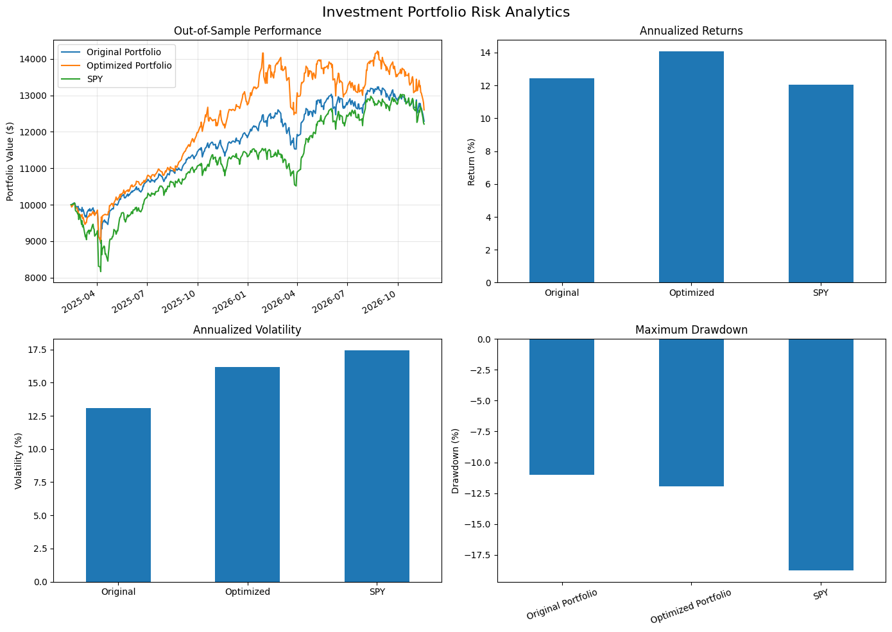
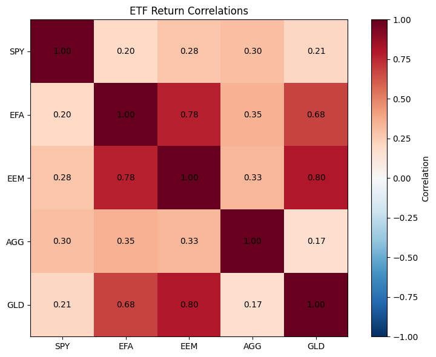

# Portfolio Risk Analytics

An applied Python project testing whether a **walk-forward Sharpe-ratio optimizer** adds value over a fixed diversified ETF portfolio once rebalancing and transaction costs are included.

## Research design

- **Assets:** SPY, EFA, EEM, AGG and GLD; USD-denominated adjusted ETF prices.
- **Baseline:** SPY 40%, EFA 20%, EEM 10%, AGG 20%, GLD 10%.
- **Optimizer:** trailing 504 trading days, first trading day of each month, maximize estimated arithmetic Sharpe ratio; long-only weights and a 60% maximum per asset.
- **Execution:** monthly rebalancing, weight drift between rebalances, hypothetical $10,000 initial value, 0.10% fee per traded notional.
- **Risk:** annualized volatility, geometric annual return, Sharpe ratio, historical 95% daily VaR, expected shortfall, maximum drawdown, return correlations and variance contribution.
- **Out-of-sample period:** depends on data availability, usually from around February 2023. The notebook uses a fixed download end of 19 November 2026 (exclusive).

## Reported results from the original Colab notebook

The uploaded original notebook reported the following results for **1 February 2023 to 18 November 2026**, before this cleanup:

| Metric | Original | Optimized |
| --- | ---: | ---: |
| Annualized return | 13.48% | 16.84% |
| Annualized volatility | 11.16% | 14.11% |
| Sharpe ratio | 0.9385 | 0.9804 |
| Maximum drawdown | -10.94% | -17.63% |
| Total transaction costs, $10k initial capital | $20.58 | $147.12 |
| Cumulative turnover | 177.82% | 939.09% |

**Important:** These are retained from the user's previously executed notebook, **not newly reproduced outputs**. The cleaned implementation includes a more consistent return and drawdown calculation. Rerun all cells and use the resulting comparison as the canonical final figures; results may differ with revisions to adjusted prices or methodology.

The optimized portfolio generated a higher annualized return and a modest Sharpe improvement in the earlier run, but suffered a deeper maximum drawdown and much higher turnover. It is not evidence of persistent future outperformance.

## Charts and illustrations

The repository includes archived figures extracted **directly from the executed original Colab notebook**:

These images preserve earlier exploratory analyses. **They are not rerendered from the cleaned final implementation, and some reflect earlier in-sample or 70/30 experiments**, so they must not be treated as validated outputs of the cleaned monthly backtest. The notebook itself is the source of truth for the current methodology.

When you rerun `portfolio_analysis.ipynb`, it automatically saves **fresh** `figures/backtest_dashboard_current_run.png` and `figures/correlation_matrix_current_run.png`. Copy those figures from Colab into the repository and replace the archived dashboard in this README with the current figure once you verify the results.

## Run

1. Open `portfolio_analysis.ipynb` in [Google Colab](https://colab.research.google.com/).
2. Install dependencies if prompted (`%pip install -r requirements.txt` in a local environment; in Colab uncomment the inline install command).
3. Select **Runtime > Run all**. An internet connection is required to download Yahoo Finance price data.
4. Inspect the final comparison table and the charts. Do not treat the earlier reported results above as verified until you rerun the notebook.

## Limitations

Historical ETF selection can introduce survivorship/selection bias; arithmetic return optimization is sensitive to estimation error. The 3% risk-free rate and 10 bps trading cost are assumptions. Returns are computed from provider-adjusted daily closing prices, with simplified execution at the start of the next test day. No variable spreads, market impact, taxes or leverage are modelled. The SPY benchmark is not risk-matched. This is educational analysis, not investment advice.

## Files

- `portfolio_analysis.ipynb`: single canonical end-to-end notebook
- `requirements.txt`: Python dependencies
- `figures/`: five archived, rendered plots extracted from the original executed notebook; the cleaned notebook exports two refreshed plots when rerun

## Next improvements

- Add an explicit data snapshot so backtest outputs are reproducible without live price revisions.
- Use historical USD Treasury bill returns for Sharpe calculations.
- Stress-test different lookback windows, asset constraints and costs.
- Evaluate optimized weights against a risk-matched benchmark and other market regimes.
