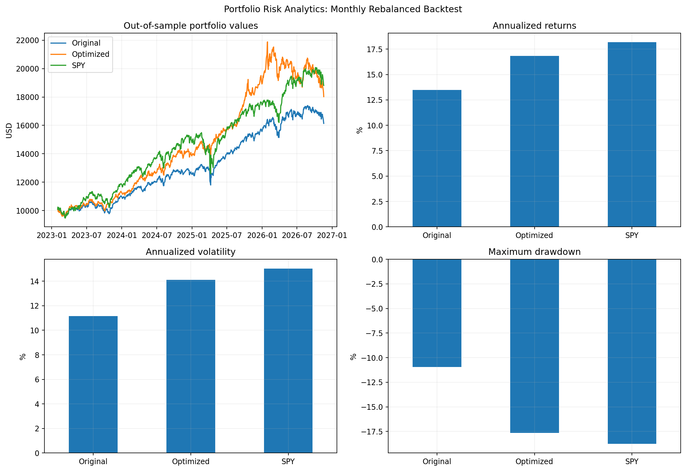
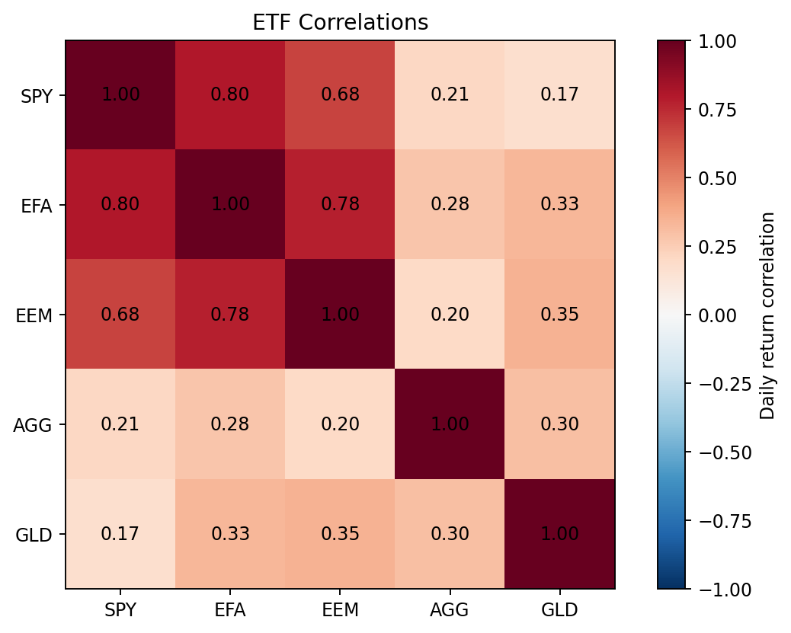

# Portfolio Risk Analytics

An applied Python project testing whether a **walk-forward Sharpe-ratio optimizer** adds value over a fixed diversified ETF portfolio once rebalancing and transaction costs are included.

## Research design

- **Assets:** SPY, EFA, EEM, AGG and GLD; USD-denominated adjusted ETF prices.
- **Baseline:** SPY 40%, EFA 20%, EEM 10%, AGG 20%, GLD 10%.
- **Optimizer:** trailing 504 trading days, first trading day of each month, maximize estimated arithmetic Sharpe ratio; long-only weights and a 60% maximum per asset.
- **Execution:** monthly rebalancing, weight drift between rebalances, hypothetical $10,000 initial value, 0.10% fee per traded notional.
- **Risk:** annualized volatility, geometric annual return, Sharpe ratio, historical 95% daily VaR, expected shortfall, maximum drawdown, return correlations and variance contribution.
- **Out-of-sample period:** depends on data availability, usually from around February 2023. The notebook uses a fixed download end of 19 November 2026 (exclusive).

## Final backtest results

The following results are from the executed cleaned notebook, covering **1 February 2023 to 18 November 2026**.

| Metric | Original | Optimized | SPY |
| --- | ---: | ---: | ---: |
| Annualized return | 13.48% | 16.84% | 18.17% |
| Annualized volatility | 11.16% | 14.11% | 15.03% |
| Sharpe ratio | 0.9385 | 0.9806 | 1.0093 |
| Maximum drawdown | -10.94% | -17.63% | -18.76% |
| Transaction costs ($10k initial capital) | $20.58 | $147.13 | $10.00 |

The optimized portfolio outperformed the original diversified allocation in returns and Sharpe ratio, but experienced higher volatility, deeper drawdowns and significantly greater turnover.

SPY achieved the highest absolute and risk-adjusted returns over this period. The optimized portfolio had lower volatility and a smaller maximum drawdown than SPY.

These findings illustrate the trade-offs of diversification and the sensitivity of portfolio optimization to historical estimates. Past performance does not establish future outperformance.

## Charts and illustrations

The following charts were generated from the final cleaned portfolio analysis notebook:

## Run

1. Open `portfolio_analysis.ipynb` in [Google Colab](https://colab.research.google.com/).
2. Install dependencies if prompted (`%pip install -r requirements.txt` in a local environment; in Colab uncomment the inline install command).
3. Select **Runtime > Run all**. An internet connection is required to download Yahoo Finance price data.
4. Inspect the comparison table and generated charts. Results may change if Yahoo Finance revises its historical price data.

## Limitations

Historical ETF selection can introduce survivorship/selection bias; arithmetic return optimization is sensitive to estimation error. The 3% risk-free rate and 10 bps trading cost are assumptions. Returns are computed from provider-adjusted daily closing prices, with simplified execution at the start of the next test day. No variable spreads, market impact, taxes or leverage are modelled. The SPY benchmark is not risk-matched. Trading is modelled using simplified daily returns and transaction costs rather than actual execution prices, bid-ask spreads and market impact. This is educational analysis, not investment advice.

## Files

- `portfolio_analysis.ipynb`: single canonical end-to-end notebook
- `requirements.txt`: Python dependencies
- `figures/`: five archived exploratory charts and two updated charts generated by the final cleaned notebook.

## Next improvements

- Add an explicit data snapshot so backtest outputs are reproducible without live price revisions.
- Use historical USD Treasury bill returns for Sharpe calculations.
- Stress-test different lookback windows, asset constraints and costs.
- Evaluate optimized weights against a risk-matched benchmark and other market regimes.
